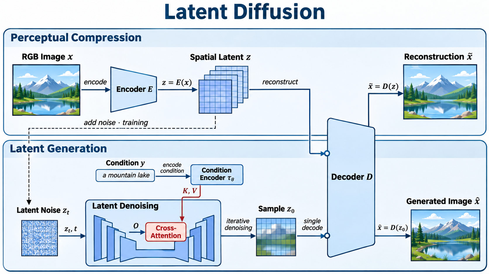
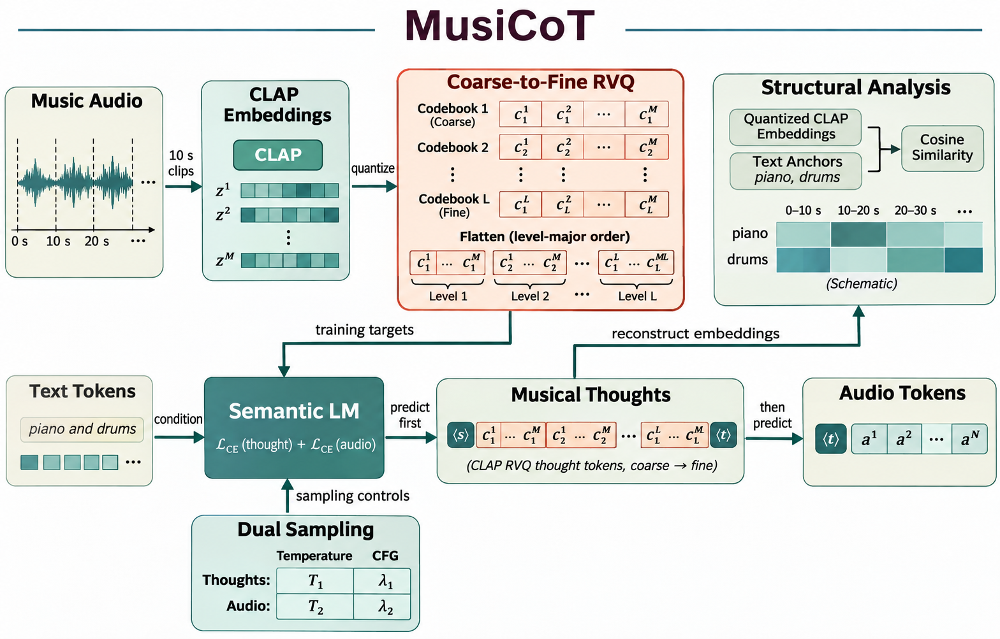
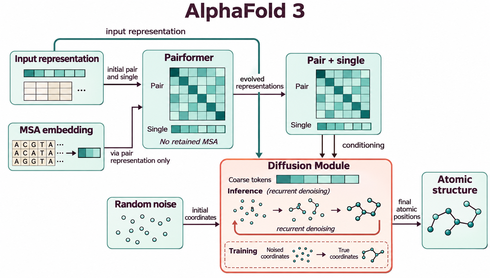
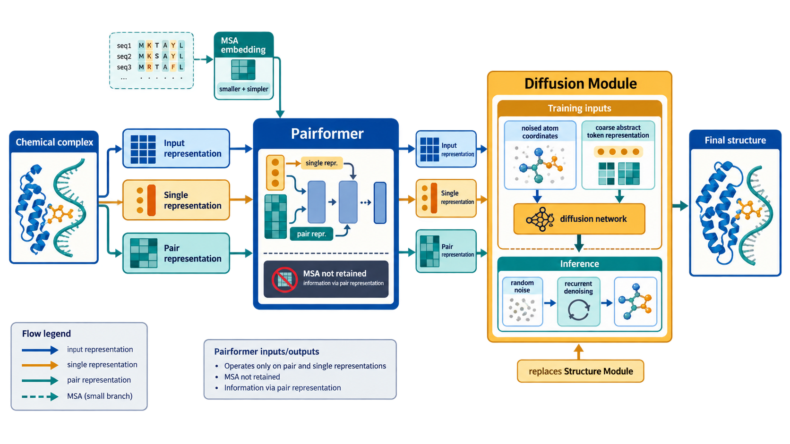

<div align="center">

# FigFox-Gen-skill · V2

### Source-grounded visual planning for one scientific figure.

**Methodology + peer evidence · need-driven construction · scoped style traits · 14 palette groups · final PNG1**

[中文说明](./README_ZH.md) · [Installation](#installation) · [Workflow](#workflow) · [Examples](#examples) · [Version guide](references/versions.md)

</div>

Development trial: [rectangular layouts, connector corrections and request timings](examples/regular-layout-trial/README.md). Optional [direct visual insets](references/direct-visual-insets.md) retain selected content assets instead of redrawing them.


V2 is the default on `main`, released as `v2.0.0`. It turns a scientific Methodology into
one labelled PNG1 through a compact, evidence-grounded drawing plan. Detail explains the
method's actual innovations; supporting stages stay at a consistent level. The output is
a raster figure planned with human-editable construction logic, not an editable SVG file.
Authors must inspect the generated pixels before using the figure.

## Installation

Requires Node.js 22.20 or later for the [skills CLI](https://github.com/vercel-labs/skills).
Install the default version, selecting Codex when prompted:

```bash
npx skills@latest add LawrenceRiver/FigFox-Gen-skill --skill FigFox-Gen-skill
```

The CLI installs into the current project by default; add `-g` for all projects or
`-a codex` to select Codex directly. Existing installed copies require an explicit update:

```bash
npx skills@latest check
npx skills@latest update FigFox-Gen-skill
```

Remote repository changes do not automatically update a local installation. If an older
copy was installed manually or pinned to V1, use the V2 install command above to switch
sources. Preserve any local customizations first. To pin a release or keep V1 alongside V2,
see the [version guide](references/versions.md).

From the installed skill directory, check the bundled files:

```bash
python scripts/check_installation.py
```

Provide a Methodology and optional reference images. General requests use V2; the preserved
V1 skill has a separate name, `figfox-gen-v1`, and requires explicit invocation.

## Workflow

```text
Methodology + about two inspected peer figures
  → one source-grounded visual-needs anchor
  → parallel construction evidence / liked style traits / palette selection
  → need-to-drawing correspondence + scientific graph
  → Creative Director: innovation detail, whole-frame grid, notation and routes
  → deterministic V2 grid/route preflight → compact Prompt 1
  → one image-generation call → optional direct-content inset placement → final PNG1 → author inspection
```

1. **Anchor once.** Inspect about two relevant scholarly figures and retain shared visual
   conventions only when the Methodology needs them. Preserve exact scientific components,
   directed relationships, source-supported claims and assumptions.
2. **Build from needs.** In parallel, inspect useful construction evidence, identify liked
   reference traits and select a compatible palette from the 14 bundled groups. A reference
   has a scoped role—such as typography, line character or a local construction. It does
   not license copying the whole composition, labels or colours. Each selected visual need
   gets a concrete drawing correspondence; there is no image-search quota per component.
3. **Plan the entire frame.** The Creative Director allocates detail to the innovation and
   fixes a regular row/column layout including the output. Use concise scientific captions
   and approved notation aliases with real subscripts/superscripts; visible underscores are
   rejected. Palette selection is per run, with no hardcoded demo hue theme.
4. **Route before generation.** Declare exact node ports and path points. The deterministic
   V2 grid/route preflight checks the planned geometry: keep the mainline to at most one
   bend and avoid crossings. An unavoidable crossing needs an explicit continuous bridge
   or a distinct, approved ink treatment. Move components to improve routes before locking
   the packet; do not hide broken shafts behind text.
5. **Generate once.** Compile the compact drawing packet and make one image call for PNG1.
   In no-reference mode the manifest has `attachments: []`; omit image-input arguments
   (`referenced_image_paths` and `num_last_images_to_include`) from the image-generation call.
   When selected direct-content assets are used, reserve clean regions and place the collected files with the optional deterministic helper after generation; that composite is PNG1. This is no additional model call. The normal workflow ends at this single PNG1, without an automatic repair loop.

File, graph, notation and geometry validation checks the declared artifacts. It does **not**
prove that the generated pixels preserve scientific meaning, labels, arrowheads, symbols,
spacing or visual quality. Inspect the actual PNG1 before accepting it.

See [SKILL.md](SKILL.md) for execution instructions and
[the compact generation contract](references/compact-generation.md) for artifacts and commands.
The original detailed workflow remains in the
[V1 tagged documentation](https://github.com/LawrenceRiver/FigFox-Gen-skill/blob/v1.0.0/README.md).

## Examples

### V2 previews — author inspection required

These three V2 runs are previews with known small symbol or connector issues. They are
not high-fidelity verified finals and must be checked against their source Methodologies.
The [complete recorded inputs](#full-methodology-inputs) remain below.

| Methodology | V2 preview |
|---|---|
| **Latent Diffusion** · [Rombach et al.](https://arxiv.org/abs/2112.10752) |  |
| **MusiCoT** · [source paper](https://arxiv.org/abs/2503.19611) |  |
| **AlphaFold 3** · [Abramson et al.](https://www.nature.com/articles/s41586-024-07487-w) |  |

### Preserved V1 examples

These original assets remain unchanged as V1 examples, including both workflow overviews
and the historical palette preview (which depicts the older library).

| V1 Methodology | Original V1 result |
|---|---|
| Latent Diffusion |  |
| MusiCoT |  |
| AlphaFold 3 |  |

[V1 English workflow](assets/generated-figures/01-figfox-gen-workflow.png) ·
[V1 Chinese workflow](assets/generated-figures/01-figfox-gen-workflow-zh.png) ·
[V1 FigureBench/palette preview](assets/figurebench-palette-preview.png)

## Full Methodology inputs

These examples preserve the original Methodology inputs rather than replacing them with
keyword-only summaries. They are recorded source inputs for the workflow, not
reconstructions of the cited papers' figures. The V1 generated figures above are original
interpretations and must not copy the source figures.

### Latent Diffusion · visual generation

**Source:** Rombach et al., [*High-Resolution Image Synthesis with Latent Diffusion Models*](https://arxiv.org/abs/2112.10752), §3. The following is the recorded Methodology input; the source paper remains authoritative.

<details>
<summary>Methodology input (verbatim)</summary>

> We propose to circumvent this drawback by introducing an explicit separation of the compressive from the generative learning phase. To achieve this, we utilize an autoencoding model which learns a space that is perceptually equivalent to the image space, but offers significantly reduced computational complexity. By leaving the high-dimensional image space, we obtain DMs which are much more computationally efficient because sampling is performed on a low-dimensional space. We exploit the inductive bias of DMs inherited from their UNet architecture, which makes them particularly effective for data with spatial structure.
>
> Given an image x in RGB space, the encoder E encodes x into a latent representation z = E(x), and the decoder D reconstructs the image from the latent, giving x-tilde = D(z) = D(E(x)). Our subsequent DM is designed to work with the two-dimensional structure of our learned latent space z = E(x). The neural backbone of our model is realized as a time-conditional UNet. Samples from p(z) can be decoded to image space with a single pass through D. We turn DMs into more flexible conditional image generators by augmenting their underlying UNet backbone with the cross-attention mechanism.

</details>

**Labels derived from the original Methodology:** `Image x`, `Encoder E`, `Latent z`, `Denoising U-Net`, `Cross-Attention`, `Condition y`, `Decoder D`, and `Generated image`.

**Generated figure:** [Latent Diffusion PNG](assets/generated-figures/02-latent-diffusion.png)

### MusiCoT · music generation

**Source:** [*MusiCoT: Analyzable Chain-of-Musical-Thought Prompting*](https://arxiv.org/abs/2503.19611), §4.1–§4.3. The following is the recorded Methodology input; the source paper remains authoritative.

<details>
<summary>Methodology input (verbatim)</summary>

> This paper proposes a novel approach to representing intermediate musical thoughts using the contrastively trained cross-domain embedding model, known as the CLAP model, rather than relying on natural language descriptions. Specifically, the CLAP model encodes segments of music audio into continuous-valued embeddings every 10 seconds. For a typical 3-minute song, this results in a sequence of audio embeddings. Each embedding, corresponding to a 10-second clip, is analyzable that allows for cosine similarity calculations against any relevant text.
>
> To tackle this issue, we introduce a residual vector quantization (RVQ) based coarse-to-fine tokenization method. This RVQ model consists of L codebooks. In MusiCoT, we arrange the RVQ tokens in a flattened coarse-to-fine sequence for LM prediction, ensuring that coarser tokens are predicted before finer ones. During training, the semantic LM utilizes the flattened CLAP RVQ tokens as additional prediction targets. We integrate tokens from three domains: text tokens, flattened CLAP RVQ tokens, and audio tokens, into a single LM. We introduce a dual-temperature sampling method and a dual-scale CFG sampling strategy for MusiCoT.

</details>

**Labels derived from the original Methodology:** `Text prompt`, `Audio clips`, `CLAP embeddings`, `RVQ codebooks`, `Coarse-to-fine thought tokens`, `Semantic LM`, `Audio tokens`, and `Music sample`.

**Generated figure:** [MusiCoT PNG](assets/generated-figures/03-musicot.png)

### AlphaFold 3 · biomolecular structure

**Source:** Abramson et al., [*Accurate structure prediction of biomolecular interactions with AlphaFold 3*](https://www.nature.com/articles/s41586-024-07487-w), “Network architecture and training.” The following is the recorded Methodology input; the source article remains authoritative.

<details>
<summary>Methodology input (verbatim)</summary>

> The overall structure of AF3 echoes that of AlphaFold 2 with a large trunk evolving a pairwise representation of the chemical complex followed by a Structure Module that uses the pairwise representation to generate explicit atomic positions, but there are large differences in each major component. Within the trunk, MSA processing is substantially de-emphasized with a much smaller and simpler MSA embedding block. The “Pairformer” replaces the “Evoformer” of AlphaFold 2 as the dominant processing block. It operates only on the pair representation and the single representation; the MSA representation is not retained and all information passes via the pair representation.
>
> The resulting pair and single representation together with the input representation are passed to the new Diffusion Module that replaces Structure Module of AlphaFold 2. The Diffusion Module operates directly on raw atom coordinates, and on a coarse abstract token representation. The diffusion model is trained to receive “noised” atomic coordinates then predict the true coordinates. At inference time, random noise is sampled and then recurrently denoised to produce a final structure.

</details>

**Labels derived from the original Methodology:** `Chemical complex`, `MSA embedding`, `Pair representation`, `Single representation`, `Pairformer`, `Noised atom coordinates`, `Diffusion Module`, and `Final structure`.

**Generated figure:** [AlphaFold 3 PNG](assets/generated-figures/04-alphafold3.png)

## Bundled reference pack

The skill includes exactly 30 complete, indexed and attributed FigureBench development
images for construction evidence, and **14 named palette groups**. Ordinary users do not download FigureBench. Official test images are not used. FigureBench supplies
geometry and layout evidence, not active palette colours; FigFoxBench is a distinct source.

See [image attributions](assets/figurebench-references/index.json). Source availability or
dataset membership does not establish redistribution permission. Keep user images and
unresolved reference assets local.

## Maintainers

`scripts/curate_figurebench_reference_pack.py` is for pack curation;
`scripts/figure_workflow.py` handles runtime artifacts and validation.

```bash
python scripts/check_installation.py
python -m unittest discover -s tests -v
```

Passing these checks does not certify the generated image. Version identity, pinned
installation and migration details are in [references/versions.md](references/versions.md).
