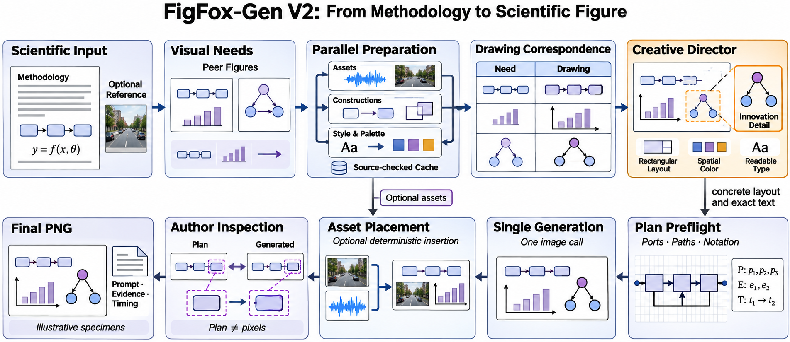
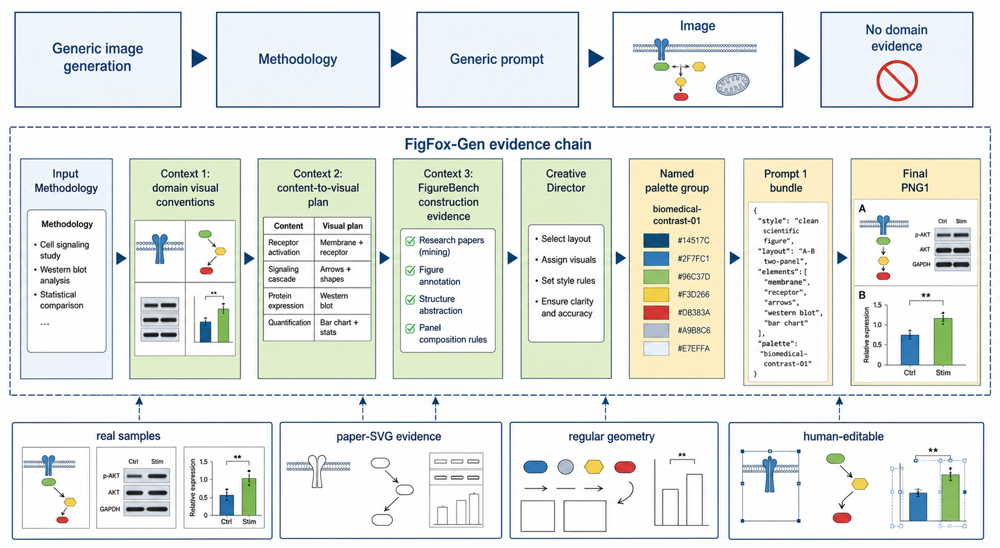
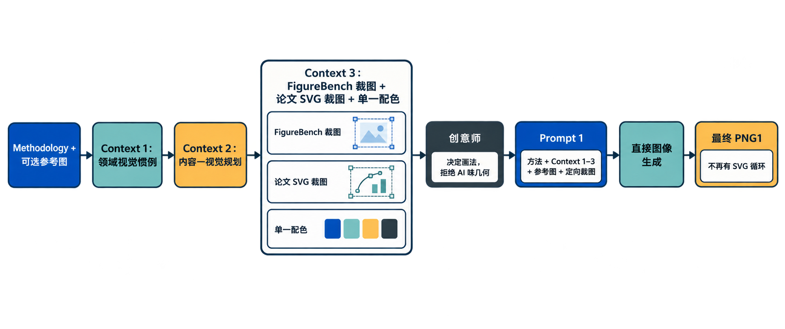
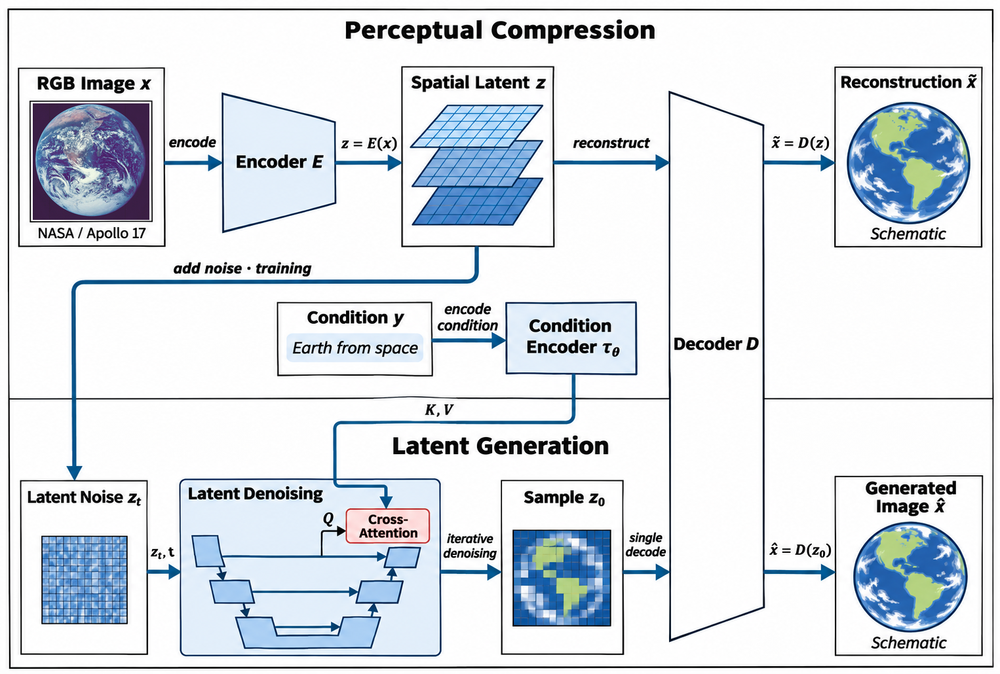
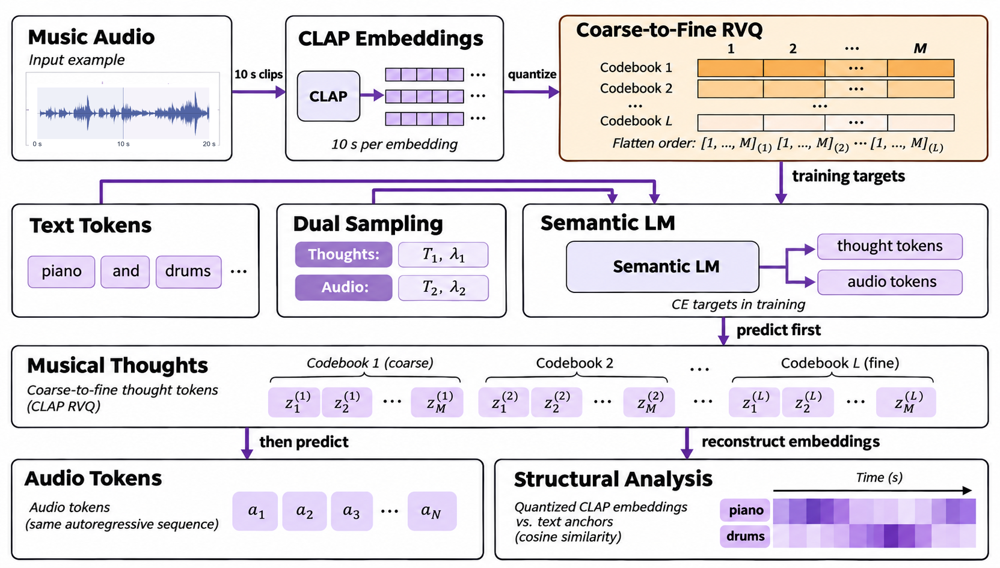
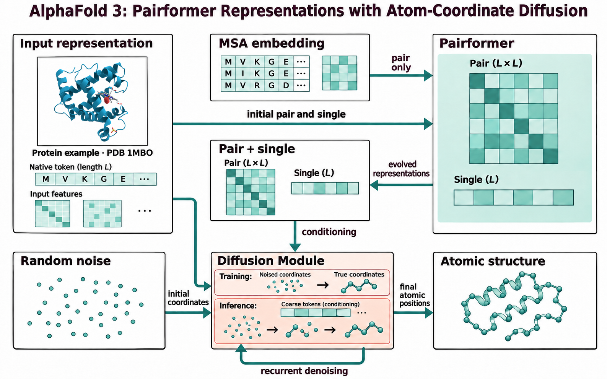
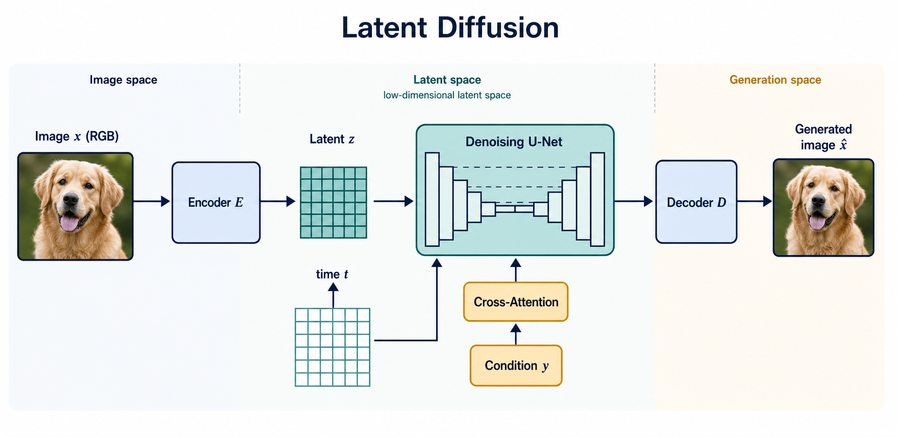
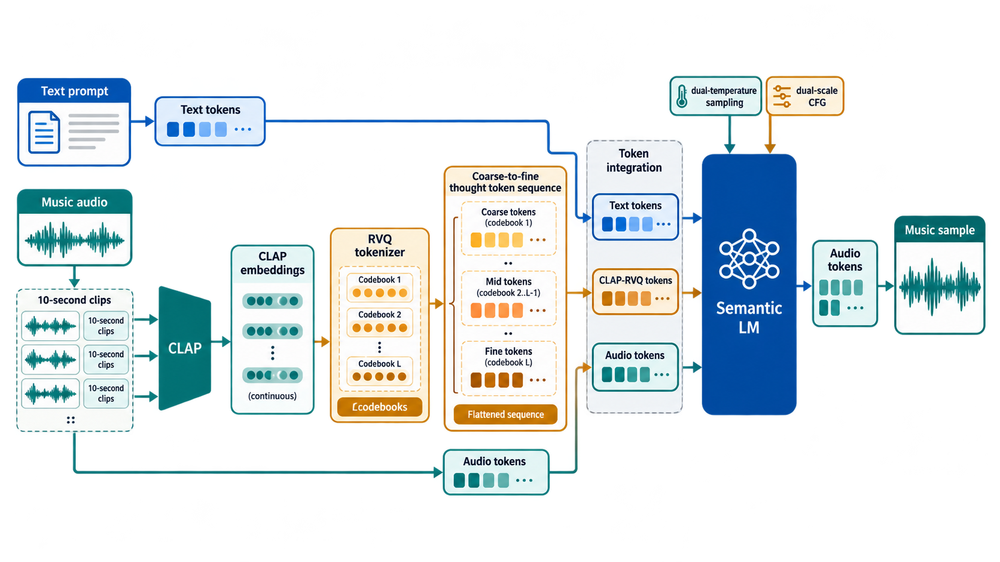

<div align="center">

# FigFox-Gen-skill · V2

### Source-grounded visual planning for one scientific figure.
### 从 Methodology 和真实证据出发，生成一张科研图。

**Methodology + peer evidence · need-driven construction · scoped style traits · 14 palette groups · final PNG1**

**同类图需求锚点 · 按需配图 · 有范围的风格借鉴 · 14 组配色 · 最终 PNG1**

[V2 architecture / V2 架构](#v2-architecture--v2-架构总览) · [Installation / 安装](#installation) · [Workflow / 工作流程](#workflow) · [Examples / 案例](#examples) · [Version guide / 版本说明](references/versions.md)

</div>

## V2 architecture / V2 架构总览

Current default workflow, visualized with FigFox-Gen itself. / 用 FigFox-Gen 自身绘制当前默认版本的完整流程。



[Methodology & generation record / 方法正文与生成记录](examples/v2-architecture/README.md)

[Editable SVG / 可编辑 SVG](assets/generated-figures/figfox-gen-v2-architecture-editable.svg) · [SVG preview / SVG 渲染预览](assets/generated-figures/figfox-gen-v2-architecture-editable.png) · [Source comparison & editability / 原图对照与可编辑性](examples/v2-architecture/editable/README.md)

V2 is the default on `main`, released as `v2.1.0`. It turns a scientific Methodology
into one raster PNG1 through a source-grounded drawing plan. Detail follows the method's
actual innovations; supporting stages stay at a consistent level. Cached, parallel work
resolves the selected visual needs, scoped reference traits and palette before a Creative
Director fixes the complete rectangular layout and exact connector geometry.

`main` 默认提供 V2，发布版本为 `v2.1.0`。它从科学 Methodology 出发，形成
有来源依据的绘图计划，交付一张栅格 PNG1。细节服务于方法的实际创新，辅助模块保持
一致层级；复用已核实的缓存，按视觉需求并行处理构件证据、参考特征与配色，再由
创意师确定完整矩形布局和精确连线几何。

Default visual priority: complete rectangular composition, regular partitions, then directional simplicity within that frame. White space and black text dominate; very pale fills identify important content, while supporting regions remain mostly unfilled.

默认视觉优先级为：完整矩形整体、规整分区、在框内尽可能单向传导。以白底、黑字和浅色为主；只对重要内容定向着色，普通支撑区域尽量留白。

V2 includes canonical model constructions at the needed granularity, bold headings on the
ordinary background, colour emphasis on scientific content, and a coherent arrow family
that can include broad, rounded or hand-drawn shafts. Optional licensed content insets
retain the actual collected pixels through deterministic placement. One layout image call
produces the figure; the generated image or inset composite is the single final PNG1.
Authors inspect the actual pixels before accepting it. Editable SVG is not a deliverable.

V2 按所需粒度采用标准模型的经典结构画法，默认在普通背景上使用粗体标题，把
颜色重点留给科学内容；箭头采用统一的比例与风格，可使用粗杆、圆角或手绘线条。
按需选用且已获使用许可的内容插图，通过确定性贴入保留实际素材像素。只调用一次
图像模型生成布局；生成图或贴入素材后的合成图就是唯一最终 PNG1，由作者检查实际
像素后决定是否接受，不承诺可编辑 SVG。

See the [earlier preview examples and recorded checks](examples/v3-0-1/README.md), the earlier
[layout and connector trial](examples/regular-layout-trial/README.md), and the
[direct visual inset contract](references/direct-visual-insets.md). The former standalone V2 entry has been retired; the current workflow is the default V2. V1 remains available through the explicit `$figfox-gen-v1` entry.

查看 [此前的预览案例与检查记录](examples/v3-0-1/README.md)、此前的
[布局和连线对照](examples/regular-layout-trial/README.md)，以及
[直接视觉插图合同](references/direct-visual-insets.md)。旧的独立 V2 入口已移除，当前流程统一为默认 V2；V1 仍可通过 `$figfox-gen-v1` 明确调用。

## What is new in V2

**V2 更新亮点**

1. **No more overcolored Mermaid-style topology diagrams.** Use a primary visual reference to unify constructions, arrows and typography into a coherent scientific figure.

   **不再出现过度配色的 Mermaid 式拓扑图。** 用主视觉参考统一图形、箭头和字体，让生成结果具有真正科研架构图的构造感。

2. **Truly simpler logical layouts.** Explore reverse-C, S-shaped and circular arrangements while preserving alignment, clear directional flow and individually checked connections.

   **真正从简的逻辑布局。** 支持反 C、S 型和环形等排布，整体规整、饱满、对齐，尽可能单向传导，并逐条复查实际箭头的逻辑走向。

3. **Counterintuitive spatial color rules.** Use related pale colors for neighboring modules, stronger differences across separated regions and usually one accent for the key mechanism.

   **反直觉的空间配色要求。** 相邻模块用相近浅色过渡，远处才拉开色彩差异，关键机制通常只保留一种强调色。

4. **Power up with image insets.** Directly incorporate relevant visuals, such as audio waveforms and street views, into the scientific framework.

   **图片插入开挂。** 音频波形、街景等外部图片可以按科学需要直接嵌入框架图，让具体内容进入方法表达。

5. **Expert-level compression.** Aim for about 100 words, remove repetition and gray microcopy, and use comparable papers’ contribution-level detail to guide how deeply each innovation is explained, with user-adjustable constraints.

   **专家式文字压缩。** 默认靠近 100 词，删除重复解释和灰色微字，并参考同类论文的创新粒度决定自己的细节展开程度，框架创新讲框架、层级创新讲层级，用户可按需求调整。

We have also released [PosFox-Gen-skill](https://github.com/LawrenceRiver/PosFox-Gen-skill) for turning scientific papers into research poster images.

我们也已发布 [PosFox-Gen-skill](https://github.com/LawrenceRiver/PosFox-Gen-skill)，用于将科学论文生成为科研海报图片。

## Workflow overview

**V1 original workflow / V1 原版流程图**

The original V1 overview figures are preserved unchanged below; the current V2 architecture is featured at the top of this page.
The two figures are intentionally different compositions: the English version
uses a horizontal evidence chain, while the Chinese version uses a vertical spine with
side evidence branches.

V1 原有流程图在此原样保留，当前 V2 架构图已在首页上方重点展示。两张总览图采用不同构图：英文版是横向证据链，中文版是带两侧证据分支的自上而下主轴。

<div align="center">
  <table>
    <tr>
      <td width="72%" valign="top"></td>
      <td width="28%" valign="top"></td>
    </tr>
  </table>
</div>

## Installation

Requires Node.js 22.20 or later for the [skills CLI](https://github.com/vercel-labs/skills).
Install the default version, selecting Codex when prompted:

```bash
npx skills@latest add LawrenceRiver/FigFox-Gen-skill --skill FigFox-Gen-skill
```

The CLI installs into the current project by default; add `-g` for all projects or
`-a codex` to select Codex directly. Existing installed copies require an explicit update:

```bash
npx skills@latest check
npx skills@latest update FigFox-Gen-skill
```

Remote repository changes do not automatically update a local installation. If an older
copy was installed manually or pinned to V1, use the V2 install command above to switch
sources. Preserve any local customizations first. To pin a release or keep V1 alongside V2,
see the [version guide](references/versions.md).

From the installed skill directory, check the bundled files:

```bash
python scripts/check_installation.py
```

Provide a Methodology and optional reference images. General requests use V2; the preserved
V1 skill has a separate name, `figfox-gen-v1`, and requires explicit invocation.

## Workflow

```text
Methodology + about two inspected peer figures
  → one source-grounded visual-needs anchor
  → cached parallel construction evidence / scoped style traits / palette selection
  → need-to-drawing correspondence + scientific graph
  → Creative Director: innovation detail, whole-frame grid, notation and routes
  → deterministic V2 grid/route preflight → compact Prompt 1
  → one layout image call → optional deterministic content-inset placement → final PNG1 → author inspection
```

1. **Anchor once.** Inspect about two relevant scholarly figures and retain shared visual
   conventions only when the Methodology needs them. Preserve exact scientific components,
   directed relationships, source-supported claims and assumptions.
2. **Build from needs.** In parallel, inspect useful construction evidence, identify liked
   reference traits and select a compatible palette from the 14 bundled groups. A reference
   has a scoped role—such as typography, line character or a local construction. It does
   not license copying the whole composition, labels or colours. Each selected visual need
   gets a concrete drawing correspondence; there is no image-search quota per component.
   Reuse source-checked caches and search again only for a named unresolved need. For a
   standard model named in the Methodology, use its established architectural grammar at
   the chosen detail level rather than an invented symbol or unnecessarily expanded internals.
3. **Plan the entire frame.** The Creative Director allocates detail to the innovation and
   fixes a regular row/column layout including the output. Use concise scientific captions
   and approved notation aliases with real subscripts/superscripts; visible underscores are
   rejected. Keep the output within the same rectangular footprint and align sibling
   regions, edges and spacing. Default to bold dark or theme-coloured headings on the
   ordinary background; use colour fill for important mechanisms and content, rather than
   automatic painted title strips. Palette selection is per run, with no hardcoded demo hue theme.
4. **Route before generation.** Declare exact node ports and path points. The deterministic
   V2 grid/route preflight checks the planned geometry: keep the mainline to at most one
   bend and avoid crossings. An unavoidable crossing needs an explicit continuous bridge
   or a distinct, approved ink treatment. Move components to improve routes before locking
   the packet; do not hide broken shafts behind text.
5. **Generate once.** Compile the compact drawing packet and make one layout image call.
   In no-reference mode the manifest has `attachments: []`; omit image-input arguments
   (`referenced_image_paths` and `num_last_images_to_include`) from the image-generation call.
   When suitable content assets have been inspected and licensed for use, reserve clean
   inset slots and paste the actual collected files with the optional deterministic helper
   after generation; that composite is PNG1. Keep source, crop, permission and placement
   records. Illustrative material must stay illustrative and cannot replace the method's
   evidence. Without insets, the generated image is PNG1. The normal workflow ends at this
   single raster PNG1 for inspection, without an automatic repair loop or extra model call.

File, graph, notation and geometry validation checks the declared artifacts. It does **not**
prove that the generated pixels preserve scientific meaning, labels, arrowheads, symbols,
spacing or visual quality. Inspect the actual PNG1 before accepting it.

See [SKILL.md](SKILL.md) for execution instructions and
[the compact generation contract](references/compact-generation.md) for artifacts and commands.
The original detailed workflow remains in the
[V1 tagged documentation](https://github.com/LawrenceRiver/FigFox-Gen-skill/blob/v1.0.0/README.md).

## Examples

### Preserved previews — author inspection required

These selected outputs were generated before the V2 naming consolidation and illustrate the workflow, including the indigo/violet
and amber MusiCoT colour revision. They are previews for inspection, not a guarantee of
pixel-level scientific or visual acceptance. See the [example report](examples/v3-0-1/README.md)
for selected artifacts and checks. The [complete recorded inputs](#full-methodology-inputs)
remain below.

| Methodology | Preserved preview |
|---|---|
| **Latent Diffusion** · [Rombach et al.](https://arxiv.org/abs/2112.10752) |  |
| **MusiCoT** · [source paper](https://arxiv.org/abs/2503.19611) |  |
| **AlphaFold 3** · [Abramson et al.](https://www.nature.com/articles/s41586-024-07487-w) |  |

### Preserved V1 examples

These original assets remain unchanged as V1 examples, including both workflow overviews
and the historical palette preview (which depicts the older library).

| V1 Methodology | Original V1 result |
|---|---|
| Latent Diffusion |  |
| MusiCoT |  |
| AlphaFold 3 |  |

[V1 English workflow](assets/generated-figures/01-figfox-gen-workflow.png) ·
[V1 Chinese workflow](assets/generated-figures/01-figfox-gen-workflow-zh.png) ·
[V1 FigureBench/palette preview](assets/figurebench-palette-preview.png)

## Full Methodology inputs

These examples preserve the original Methodology inputs rather than replacing them with
keyword-only summaries. They are recorded source inputs for the workflow, not
reconstructions of the cited papers' figures. The V1 generated figures above are original
interpretations and must not copy the source figures.

### Latent Diffusion · visual generation

**Source:** Rombach et al., [*High-Resolution Image Synthesis with Latent Diffusion Models*](https://arxiv.org/abs/2112.10752), §3. The following is the recorded Methodology input; the source paper remains authoritative.

<details>
<summary>Methodology input (verbatim)</summary>

> We propose to circumvent this drawback by introducing an explicit separation of the compressive from the generative learning phase. To achieve this, we utilize an autoencoding model which learns a space that is perceptually equivalent to the image space, but offers significantly reduced computational complexity. By leaving the high-dimensional image space, we obtain DMs which are much more computationally efficient because sampling is performed on a low-dimensional space. We exploit the inductive bias of DMs inherited from their UNet architecture, which makes them particularly effective for data with spatial structure.
>
> Given an image x in RGB space, the encoder E encodes x into a latent representation z = E(x), and the decoder D reconstructs the image from the latent, giving x-tilde = D(z) = D(E(x)). Our subsequent DM is designed to work with the two-dimensional structure of our learned latent space z = E(x). The neural backbone of our model is realized as a time-conditional UNet. Samples from p(z) can be decoded to image space with a single pass through D. We turn DMs into more flexible conditional image generators by augmenting their underlying UNet backbone with the cross-attention mechanism.

</details>

**Labels derived from the original Methodology:** `Image x`, `Encoder E`, `Latent z`, `Denoising U-Net`, `Cross-Attention`, `Condition y`, `Decoder D`, and `Generated image`.

**Generated figure:** [Latent Diffusion PNG](assets/generated-figures/02-latent-diffusion.png)

### MusiCoT · music generation

**Source:** [*MusiCoT: Analyzable Chain-of-Musical-Thought Prompting*](https://arxiv.org/abs/2503.19611), §4.1–§4.3. The following is the recorded Methodology input; the source paper remains authoritative.

<details>
<summary>Methodology input (verbatim)</summary>

> This paper proposes a novel approach to representing intermediate musical thoughts using the contrastively trained cross-domain embedding model, known as the CLAP model, rather than relying on natural language descriptions. Specifically, the CLAP model encodes segments of music audio into continuous-valued embeddings every 10 seconds. For a typical 3-minute song, this results in a sequence of audio embeddings. Each embedding, corresponding to a 10-second clip, is analyzable that allows for cosine similarity calculations against any relevant text.
>
> To tackle this issue, we introduce a residual vector quantization (RVQ) based coarse-to-fine tokenization method. This RVQ model consists of L codebooks. In MusiCoT, we arrange the RVQ tokens in a flattened coarse-to-fine sequence for LM prediction, ensuring that coarser tokens are predicted before finer ones. During training, the semantic LM utilizes the flattened CLAP RVQ tokens as additional prediction targets. We integrate tokens from three domains: text tokens, flattened CLAP RVQ tokens, and audio tokens, into a single LM. We introduce a dual-temperature sampling method and a dual-scale CFG sampling strategy for MusiCoT.

</details>

**Labels derived from the original Methodology:** `Text prompt`, `Audio clips`, `CLAP embeddings`, `RVQ codebooks`, `Coarse-to-fine thought tokens`, `Semantic LM`, `Audio tokens`, and `Music sample`.

**Generated figure:** [MusiCoT PNG](assets/generated-figures/03-musicot.png)

### AlphaFold 3 · biomolecular structure

**Source:** Abramson et al., [*Accurate structure prediction of biomolecular interactions with AlphaFold 3*](https://www.nature.com/articles/s41586-024-07487-w), “Network architecture and training.” The following is the recorded Methodology input; the source article remains authoritative.

<details>
<summary>Methodology input (verbatim)</summary>

> The overall structure of AF3 echoes that of AlphaFold 2 with a large trunk evolving a pairwise representation of the chemical complex followed by a Structure Module that uses the pairwise representation to generate explicit atomic positions, but there are large differences in each major component. Within the trunk, MSA processing is substantially de-emphasized with a much smaller and simpler MSA embedding block. The “Pairformer” replaces the “Evoformer” of AlphaFold 2 as the dominant processing block. It operates only on the pair representation and the single representation; the MSA representation is not retained and all information passes via the pair representation.
>
> The resulting pair and single representation together with the input representation are passed to the new Diffusion Module that replaces Structure Module of AlphaFold 2. The Diffusion Module operates directly on raw atom coordinates, and on a coarse abstract token representation. The diffusion model is trained to receive “noised” atomic coordinates then predict the true coordinates. At inference time, random noise is sampled and then recurrently denoised to produce a final structure.

</details>

**Labels derived from the original Methodology:** `Chemical complex`, `MSA embedding`, `Pair representation`, `Single representation`, `Pairformer`, `Noised atom coordinates`, `Diffusion Module`, and `Final structure`.

**Generated figure:** [AlphaFold 3 PNG](assets/generated-figures/04-alphafold3.png)

## Bundled reference pack

The skill includes exactly 30 complete, indexed and attributed FigureBench development
images for construction evidence, and **14 named palette groups**. Ordinary users do not download FigureBench. Official test images are not used. FigureBench supplies
geometry and layout evidence, not active palette colours; FigFoxBench is a distinct source.

See [image attributions](assets/figurebench-references/index.json). Source availability or
dataset membership does not establish redistribution permission. Keep user images and
unresolved reference assets local.

## Maintainers

`scripts/curate_figurebench_reference_pack.py` is for pack curation;
`scripts/figure_workflow.py` handles runtime artifacts and validation.

```bash
python scripts/check_installation.py
python -m unittest discover -s tests -v
```

Passing these checks does not certify the generated image. Version identity, pinned
installation and migration details are in [references/versions.md](references/versions.md).
