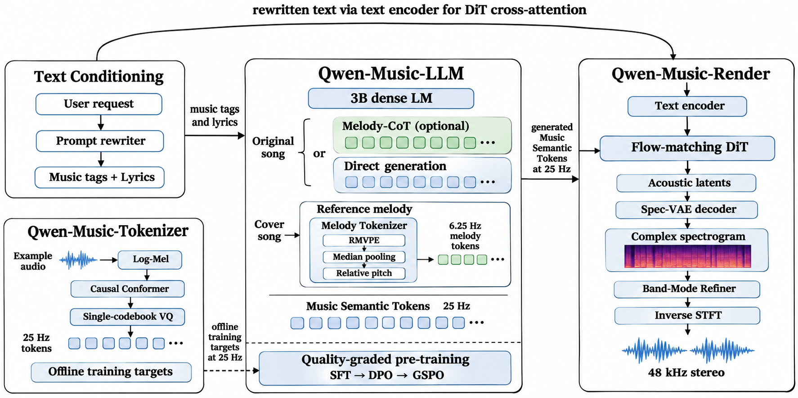

> Active workflow: SVG-only references, dedicated complete other-track SVG palette, full Creative Director colour/layout decisions, and simple routes. See [SKILL.md](SKILL.md). Fixed-library and regular-rectangle examples below are historical, not new-run mandates.

<div align="center">

# FigFox-Gen-skill · V3

### Source-grounded visual planning for one scientific figure.
### 从 Methodology 和真实证据出发，生成一张科研图。

**Methodology + peer evidence · need-driven construction · scoped style traits · SVG-derived palette · final PNG1**

**同类图需求锚点 · 按需配图 · 有范围的风格借鉴 · SVG 来源配色 · 最终 PNG1**

[V3 workflow / V3 流程](#v3--svg-reference-workflow--svg-参考流程) · [Installation / 安装](#installation) · [Workflow / 工作流程](#workflow) · [Examples / 案例](#examples) · [Version guide / 版本说明](references/versions.md)

</div>

## V3 · SVG-reference workflow / SVG 参考流程


[Editable SVG / 可编辑 SVG](examples/v3.1/architecture/editable/final.svg) · [PNG preview / PNG 预览](examples/v3.1/architecture/editable/final.png) · [Reconstruction & run illustrations / 重建与运行记录插图](examples/v3.1/architecture/editable/README.md)

[Full V3 Methodology / 完整方法正文](examples/v3.1/architecture/input/methodology.md) · [Generated with our own skill / 自己的 skill 生成记录](examples/v3.1/architecture/README.md) · [Prompt / 提示词](examples/v3.1/architecture/prompt-1/prompt.md)

Current version: **V3 (`v3.1.0`)**. / 当前版本：**V3 (`v3.1.0`)**。

- Inspect genuine vector SVG references and retain source provenance; report missing references rather than substitute raster images.
- Derive colours and their spatial relationships from one complete SVG; the Creative Director decides the final palette, composition and scientific detail.
- Place frames and plan straight or single smooth-curve routes together. Preserve genuine internal topology and keep text inside its parent region.
- Generate one PNG1 and inspect the actual image. Deterministic validation does not certify scientific or visual correctness.

真实 SVG 参考与来源记录 → 方法内容与叙事 → 完整 SVG 配色关系 → 创意师统筹配色、布局与真实内部拓扑 → 简单连线 → 单次 PNG1 → 实际图像检查。

See [the active workflow and schemas](references/svg-reference-workflow.md) and [SKILL.md](SKILL.md). Historical raster-library runs remain replayable; new runs use `svg-reference-v1`.

## Historical V2 architecture / 历史 V2 架构

The overview and V2 notes below document the previous workflow; they are retained for provenance and do not define V3 defaults. / 以下总览与 V2 说明保留历史来源，不代表 V3 默认流程。


Historical V2 workflow, generated with FigFox-Gen and reconstructed as editable SVG with FigFox. / 历史 V2 流程示例。


[Methodology & generation record / 方法正文与生成记录](examples/v2-architecture/README.md)

[Editable SVG / 可编辑 SVG](assets/generated-figures/figfox-gen-v2-architecture-editable.svg) · [SVG preview / SVG 渲染预览](assets/generated-figures/figfox-gen-v2-architecture-editable.png) · [Source comparison & editability / 原图对照与可编辑性](examples/v2-architecture/editable/README.md)

V2 was released as `v2.1.0`. It turns a scientific Methodology
into one raster PNG1 through a source-grounded drawing plan. Detail follows the method's
actual innovations; supporting stages stay at a consistent level. Cached, parallel work
resolves the selected visual needs, scoped reference traits and palette before a Creative
Director fixes the complete rectangular layout and exact connector geometry.

此前 V2 的发布版本为 `v2.1.0`。它从科学 Methodology 出发，形成
有来源依据的绘图计划，交付一张栅格 PNG1。细节服务于方法的实际创新，辅助模块保持
一致层级；复用已核实的缓存，按视觉需求并行处理构件证据、参考特征与配色，再由
创意师确定完整矩形布局和精确连线几何。

Default visual priority: complete rectangular composition, regular partitions, then directional simplicity within that frame. White space and black text dominate; very pale fills identify important content, while supporting regions remain mostly unfilled.

默认视觉优先级为：完整矩形整体、规整分区、在框内尽可能单向传导。以白底、黑字和浅色为主；只对重要内容定向着色，普通支撑区域尽量留白。

V2 includes canonical model constructions at the needed granularity, bold headings on the
ordinary background, colour emphasis on scientific content, and a coherent arrow family
that can include broad, rounded or hand-drawn shafts. Optional licensed content insets
retain the actual collected pixels through deterministic placement. One layout image call
produces the figure; the generated image or inset composite is the single final PNG1.
Authors inspect the actual pixels before accepting it. Editable SVG is not a deliverable.

V2 按所需粒度采用标准模型的经典结构画法，默认在普通背景上使用粗体标题，把
颜色重点留给科学内容；箭头采用统一的比例与风格，可使用粗杆、圆角或手绘线条。
按需选用且已获使用许可的内容插图，通过确定性贴入保留实际素材像素。只调用一次
图像模型生成布局；生成图或贴入素材后的合成图就是唯一最终 PNG1，由作者检查实际
像素后决定是否接受，不承诺可编辑 SVG。

See the [earlier preview examples and recorded checks](examples/v3-0-1/README.md), the earlier
[layout and connector trial](examples/regular-layout-trial/README.md), and the
[direct visual inset contract](references/direct-visual-insets.md). The former standalone V2 entry has been retired; the former workflow was the default V2. V1 remains available through the explicit `$figfox-gen-v1` entry.

查看 [此前的预览案例与检查记录](examples/v3-0-1/README.md)、此前的
[布局和连线对照](examples/regular-layout-trial/README.md)，以及
[直接视觉插图合同](references/direct-visual-insets.md)。旧的独立 V2 入口已移除，此前流程统一为默认 V2；V1 仍可通过 `$figfox-gen-v1` 明确调用。

## From generated figure to editable SVG / 从生成图到可编辑 SVG

After choosing a generated PNG, use the separate [FigFox skill](https://github.com/LawrenceRiver/FigFox#use-as-a-skill--作为-skill-使用) to reconstruct it as an editable SVG. Text, shapes and connectors remain native, while photos can be independently movable image elements.

生成 PNG 后，可调用独立的 [FigFox skill](https://github.com/LawrenceRiver/FigFox/tree/main/skills/figfox)，还原为可编辑 SVG：文字、图形、箭头保持原生元素，照片可独立移动与替换。

```bash
npx skills@latest add LawrenceRiver/FigFox --skill figfox
```

Use `$FigFox-Gen-skill` to create the figure, then `$figfox` to reconstruct the selected image; conversion is explicitly invoked rather than an automatic generation/repair loop.

先用 `$FigFox-Gen-skill` 生成，再用 `$figfox` 还原选定图片；两步分别调用，不自动进入重建或修图循环。

[Installation & workflow / 安装与流程](https://github.com/LawrenceRiver/FigFox/blob/main/docs/skill.md) · [Our editable V2 example / 本仓库 V2 可编辑示例](examples/v2-architecture/editable/README.md)

## Historical V2 highlights

**V2 更新亮点**

1. **No more overcolored Mermaid-style topology diagrams.** Use a primary visual reference to unify constructions, arrows and typography into a coherent scientific figure.

   **不再出现过度配色的 Mermaid 式拓扑图。** 用主视觉参考统一图形、箭头和字体，让生成结果具有真正科研架构图的构造感。

2. **Truly simpler logical layouts.** Explore reverse-C, S-shaped and circular arrangements while preserving alignment, clear directional flow and individually checked connections.

   **真正从简的逻辑布局。** 支持反 C、S 型和环形等排布，整体规整、饱满、对齐，尽可能单向传导，并逐条复查实际箭头的逻辑走向。

3. **Counterintuitive spatial color rules.** Use related pale colors for neighboring modules, stronger differences across separated regions and usually one accent for the key mechanism.

   **反直觉的空间配色要求。** 相邻模块用相近浅色过渡，远处才拉开色彩差异，关键机制通常只保留一种强调色。

4. **Power up with image insets.** Directly incorporate relevant visuals, such as audio waveforms and street views, into the scientific framework.

   **图片插入开挂。** 音频波形、街景等外部图片可以按科学需要直接嵌入框架图，让具体内容进入方法表达。

5. **Expert-level compression.** Aim for about 100 words, remove repetition and gray microcopy, and use comparable papers’ contribution-level detail to guide how deeply each innovation is explained, with user-adjustable constraints.

   **专家式文字压缩。** 默认靠近 100 词，删除重复解释和灰色微字，并参考同类论文的创新粒度决定自己的细节展开程度，框架创新讲框架、层级创新讲层级，用户可按需求调整。

## Examples · V3 / V3 新案例

Complete updated Methodology inputs and recorded checks are linked below. / 以下包含更新后的完整 Methodology 与实际检查记录。

### Qwen-Music



[Full Methodology / 完整方法正文](examples/v3.1/qwen-music/input/methodology.md) · [Prompt, sources & inspection / 提示词、来源与检查](examples/v3.1/qwen-music/README.md)

Known deviations: external connector prose and incomplete internal melody continuation. / 已记录：连线说明出框，旋律到语义输出连接仍不完整。

### AlphaGenome


[Full Methodology / 完整方法正文](examples/v3.1/alphagenome/input/methodology.md) · [Prompt, sources & inspection / 提示词、来源与检查](examples/v3.1/alphagenome/README.md)

Known deviation: some connector labels remain outside frames. Readouts are schematic. / 已记录：少量连线标签出框；读出均为示意。

### World Models · MDN-RNN


[Full Methodology / 完整方法正文](examples/v3.1/world-models/input/methodology.md) · [Prompt, sources & inspection / 提示词、来源与检查](examples/v3.1/world-models/README.md)

Known deviation: mild shading/gradients. / 已记录：局部有轻微渐变。

[All V3 run packages / 全部 V3 运行记录](examples/v3.1/README.md) · [Historical preview cases / 历史预览案例](examples/v3-0-1/README.md)

### Optional research-poster branch

The bundled [PosFox Gen Skill](skills/posfox-gen/SKILL.md) creates a poster PNG from a paper PDF. It is used only for an explicit scientific/research-poster request. Ordinary figures and methodology diagrams continue to use FigFox-Gen's default workflow; supplying a PDF or poster reference alone does not select the poster branch.

To install only that optional package:

```bash
npx skills@latest add LawrenceRiver/FigFox-Gen-skill --full-depth --skill posfox-gen
```

Ask `$posfox-gen` explicitly for a research poster. It stops at PNG generation; editable reconstruction is outside this branch.

科研海报支线已放在本仓库内。只有明确要求制作科研/学术海报时才使用；其余请求仍按科研论文图处理。该支线只交付 PNG，不自动进入可编辑重建。

## Installation

Requires Node.js 22.20 or later for the [skills CLI](https://github.com/vercel-labs/skills).
Install the default version, selecting Codex when prompted:

```bash
npx skills@latest add LawrenceRiver/FigFox-Gen-skill --skill FigFox-Gen-skill
```

The CLI installs into the current project by default; add `-g` for all projects or
`-a codex` to select Codex directly. Existing installed copies require an explicit update:

```bash
npx skills@latest check
npx skills@latest update FigFox-Gen-skill
```

Remote repository changes do not automatically update a local installation. If an older
copy was installed manually or pinned to V1, use the V2 install command above to switch
sources. Preserve any local customizations first. To pin a release or keep V1 alongside V2,
see the [version guide](references/versions.md).

From the installed skill directory, check the bundled files:

```bash
python scripts/check_installation.py
```

Provide a Methodology and optional reference images. General requests use V2; the preserved
V1 skill has a separate name, `figfox-gen-v1`, and requires explicit invocation.

## Workflow

```text
Methodology + user requirements
  → genuine SVG evidence + settled content/narrative
  → Creative Director: colour/whitespace → frames/simple routes → exact content
  → source/graph/geometry/notation checks → compact image packet
  → one image call → PNG1 → actual-pixel inspection + recorded deviations
```

1. **Settle scientific content.** Methodology defines components, directed dependencies and claims. Inspect relevant genuine SVG figures when available; keep only useful constructions and disclose missing sources. Retain SVG provenance and the need-to-drawing correspondence.
2. **Collect complete style and palette evidence.** A dedicated complete SVG from another track supplies original colours and observed adjacency, separation and whitespace. New runs do not select a fixed palette-library group. Local PNG previews are derivatives of retained SVGs.
3. **Let the Director decide.** The Creative Director integrates content and complete references, chooses source-derived colours, then places content-sized frames and simple routes together before filling exact text and meaningful local visuals. Preserve actual scientific topology. Ordinary frames usually have one input/output; justified exceptions retain true dependencies.
4. **Compile and preflight.** Verify SVGs/hashes, source-derived colour decisions, graph, notation and explicit geometry. Routes are straight or one necessary smooth curve. Reposition frames instead of adding staircase detours. The compiler preserves invariants and approved attachments in a compact prompt.
5. **Generate once and inspect.** Make one image-generation call, deliver PNG1 and inspect actual pixels. Keep the prompt, Methodology, provenance, plan and deviations. Artifact validation does not prove visual or scientific correctness. There is no automatic repair or editable-reconstruction loop.

[Full V3 Methodology](examples/v3.1/architecture/input/methodology.md) · [Active skill](SKILL.md) · [SVG schemas](references/svg-reference-workflow.md) · [Compact handoff](references/compact-generation.md)

## Historical V1 examples

These original assets remain unchanged as V1 examples, including both workflow overviews
and the historical palette preview (which depicts the older library).

| V1 Methodology | Original V1 result |
|---|---|
| Latent Diffusion |  |
| MusiCoT |  |
| AlphaFold 3 |  |

[V1 FigureBench/palette preview](assets/figurebench-palette-preview.png)

## Historical preview Methodology inputs

These examples preserve the original Methodology inputs rather than replacing them with
keyword-only summaries. They are recorded source inputs for the workflow, not
reconstructions of the cited papers' figures. The V1 generated figures above are original
interpretations and must not copy the source figures.

### Latent Diffusion · visual generation

**Source:** Rombach et al., [*High-Resolution Image Synthesis with Latent Diffusion Models*](https://arxiv.org/abs/2112.10752), §3. The following is the recorded Methodology input; the source paper remains authoritative.

<details>
<summary>Methodology input (verbatim)</summary>

> We propose to circumvent this drawback by introducing an explicit separation of the compressive from the generative learning phase. To achieve this, we utilize an autoencoding model which learns a space that is perceptually equivalent to the image space, but offers significantly reduced computational complexity. By leaving the high-dimensional image space, we obtain DMs which are much more computationally efficient because sampling is performed on a low-dimensional space. We exploit the inductive bias of DMs inherited from their UNet architecture, which makes them particularly effective for data with spatial structure.
>
> Given an image x in RGB space, the encoder E encodes x into a latent representation z = E(x), and the decoder D reconstructs the image from the latent, giving x-tilde = D(z) = D(E(x)). Our subsequent DM is designed to work with the two-dimensional structure of our learned latent space z = E(x). The neural backbone of our model is realized as a time-conditional UNet. Samples from p(z) can be decoded to image space with a single pass through D. We turn DMs into more flexible conditional image generators by augmenting their underlying UNet backbone with the cross-attention mechanism.

</details>

**Labels derived from the original Methodology:** `Image x`, `Encoder E`, `Latent z`, `Denoising U-Net`, `Cross-Attention`, `Condition y`, `Decoder D`, and `Generated image`.

**Generated figure:** [Latent Diffusion PNG](assets/generated-figures/02-latent-diffusion.png)

### MusiCoT · music generation

**Source:** [*MusiCoT: Analyzable Chain-of-Musical-Thought Prompting*](https://arxiv.org/abs/2503.19611), §4.1–§4.3. The following is the recorded Methodology input; the source paper remains authoritative.

<details>
<summary>Methodology input (verbatim)</summary>

> This paper proposes a novel approach to representing intermediate musical thoughts using the contrastively trained cross-domain embedding model, known as the CLAP model, rather than relying on natural language descriptions. Specifically, the CLAP model encodes segments of music audio into continuous-valued embeddings every 10 seconds. For a typical 3-minute song, this results in a sequence of audio embeddings. Each embedding, corresponding to a 10-second clip, is analyzable that allows for cosine similarity calculations against any relevant text.
>
> To tackle this issue, we introduce a residual vector quantization (RVQ) based coarse-to-fine tokenization method. This RVQ model consists of L codebooks. In MusiCoT, we arrange the RVQ tokens in a flattened coarse-to-fine sequence for LM prediction, ensuring that coarser tokens are predicted before finer ones. During training, the semantic LM utilizes the flattened CLAP RVQ tokens as additional prediction targets. We integrate tokens from three domains: text tokens, flattened CLAP RVQ tokens, and audio tokens, into a single LM. We introduce a dual-temperature sampling method and a dual-scale CFG sampling strategy for MusiCoT.

</details>

**Labels derived from the original Methodology:** `Text prompt`, `Audio clips`, `CLAP embeddings`, `RVQ codebooks`, `Coarse-to-fine thought tokens`, `Semantic LM`, `Audio tokens`, and `Music sample`.

**Generated figure:** [MusiCoT PNG](assets/generated-figures/03-musicot.png)

### AlphaFold 3 · biomolecular structure

**Source:** Abramson et al., [*Accurate structure prediction of biomolecular interactions with AlphaFold 3*](https://www.nature.com/articles/s41586-024-07487-w), “Network architecture and training.” The following is the recorded Methodology input; the source article remains authoritative.

<details>
<summary>Methodology input (verbatim)</summary>

> The overall structure of AF3 echoes that of AlphaFold 2 with a large trunk evolving a pairwise representation of the chemical complex followed by a Structure Module that uses the pairwise representation to generate explicit atomic positions, but there are large differences in each major component. Within the trunk, MSA processing is substantially de-emphasized with a much smaller and simpler MSA embedding block. The “Pairformer” replaces the “Evoformer” of AlphaFold 2 as the dominant processing block. It operates only on the pair representation and the single representation; the MSA representation is not retained and all information passes via the pair representation.
>
> The resulting pair and single representation together with the input representation are passed to the new Diffusion Module that replaces Structure Module of AlphaFold 2. The Diffusion Module operates directly on raw atom coordinates, and on a coarse abstract token representation. The diffusion model is trained to receive “noised” atomic coordinates then predict the true coordinates. At inference time, random noise is sampled and then recurrently denoised to produce a final structure.

</details>

**Labels derived from the original Methodology:** `Chemical complex`, `MSA embedding`, `Pair representation`, `Single representation`, `Pairformer`, `Noised atom coordinates`, `Diffusion Module`, and `Final structure`.

**Generated figure:** [AlphaFold 3 PNG](assets/generated-figures/04-alphafold3.png)

## Bundled reference pack

The skill includes exactly 30 complete, indexed and attributed FigureBench development
images for construction evidence, and **14 named palette groups**. Ordinary users do not download FigureBench. Official test images are not used. FigureBench supplies
geometry and layout evidence, not active palette colours; FigFoxBench is a distinct source.

See [image attributions](assets/figurebench-references/index.json). Source availability or
dataset membership does not establish redistribution permission. Keep user images and
unresolved reference assets local.

## Maintainers

`scripts/curate_figurebench_reference_pack.py` is for pack curation;
`scripts/figure_workflow.py` handles runtime artifacts and validation.

```bash
python scripts/check_installation.py
python -m unittest discover -s tests -v
```

Passing these checks does not certify the generated image. Version identity, pinned
installation and migration details are in [references/versions.md](references/versions.md).
