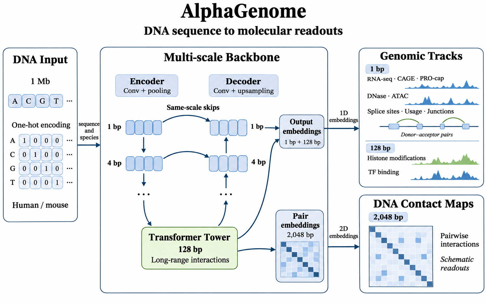
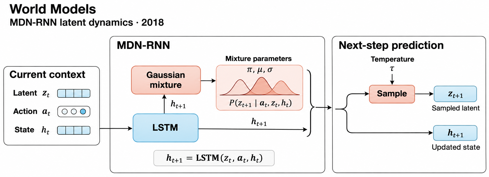
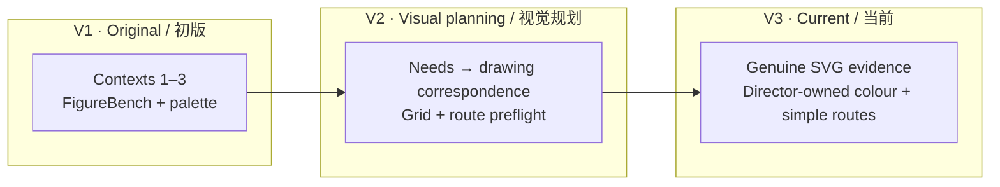

> Active workflow: SVG-only references, dedicated complete other-track SVG palette, full Creative Director colour/layout decisions, and simple routes. See [SKILL.md](SKILL.md). Fixed-library and regular-rectangle examples below are historical, not new-run mandates.

<div align="center">

# FigFox-Gen-skill · V3

### Source-grounded visual planning for one scientific figure.
### 从 Methodology 和真实证据出发，生成一张科研图。

**Methodology + peer evidence · need-driven construction · scoped style traits · SVG-derived palette · final PNG1**

**同类图需求锚点 · 按需配图 · 有范围的风格借鉴 · SVG 来源配色 · 最终 PNG1**

[V3 workflow / V3 流程](#v3--svg-reference-workflow--svg-参考流程) · [Installation / 安装](#installation) · [Workflow / 工作流程](#workflow) · [Examples / 案例](#examples) · [Version guide / 版本说明](references/versions.md)

</div>

## V3 · SVG-reference workflow / SVG 参考流程


[Editable SVG / 可编辑 SVG](examples/v3.1/architecture/editable/final.svg) · [PNG preview / PNG 预览](examples/v3.1/architecture/editable/final.png) · [Reconstruction & run illustrations / 重建与运行记录插图](examples/v3.1/architecture/editable/README.md)

[Full V3 Methodology / 完整方法正文](examples/v3.1/architecture/input/methodology.md) · [Generated with our own skill / 自己的 skill 生成记录](examples/v3.1/architecture/README.md) · [Prompt / 提示词](examples/v3.1/architecture/prompt-1/prompt.md)

Current version: **V3 (`v3.1.0`)**. / 当前版本：**V3 (`v3.1.0`)**。

- Inspect genuine vector SVG references and retain source provenance; report missing references rather than substitute raster images.
- Derive colours and their spatial relationships from one complete SVG; the Creative Director decides the final palette, composition and scientific detail.
- Place frames and plan straight or single smooth-curve routes together. Preserve genuine internal topology and keep text inside its parent region.
- Generate one PNG1 and inspect the actual image. Deterministic validation does not certify scientific or visual correctness.

真实 SVG 参考与来源记录 → 方法内容与叙事 → 完整 SVG 配色关系 → 创意师统筹配色、布局与真实内部拓扑 → 简单连线 → 单次 PNG1 → 实际图像检查。

See [the active workflow and schemas](references/svg-reference-workflow.md) and [SKILL.md](SKILL.md). New runs use `svg-reference-v1`.

## From generated figure to editable SVG / 从生成图到可编辑 SVG

After choosing a generated PNG, use the separate [FigFox skill](https://github.com/LawrenceRiver/FigFox#use-as-a-skill--作为-skill-使用) to reconstruct it as an editable SVG. Text, shapes and connectors remain native, while photos can be independently movable image elements.

生成 PNG 后，可调用独立的 [FigFox skill](https://github.com/LawrenceRiver/FigFox/tree/main/skills/figfox)，还原为可编辑 SVG：文字、图形、箭头保持原生元素，照片可独立移动与替换。

```bash
npx skills@latest add LawrenceRiver/FigFox --skill figfox
```

Use `$FigFox-Gen-skill` to create the figure, then `$figfox` to reconstruct the selected image; conversion is explicitly invoked rather than an automatic generation/repair loop.

先用 `$FigFox-Gen-skill` 生成，再用 `$figfox` 还原选定图片；两步分别调用，不自动进入重建或修图循环。

[Installation & workflow / 安装与流程](https://github.com/LawrenceRiver/FigFox/blob/main/docs/skill.md) · [Our editable V3 overview / 本仓库 V3 可编辑总览](examples/v3.1/architecture/editable/README.md)

## Examples · V3 / V3 新案例

Complete updated Methodology inputs and recorded checks are linked below. / 以下包含更新后的完整 Methodology 与实际检查记录。

### Qwen-Music


[Full Methodology / 完整方法正文](examples/v3.1/qwen-music/input/methodology.md) · [Prompt, sources & inspection / 提示词、来源与检查](examples/v3.1/qwen-music/README.md)

Known deviations: external connector prose and incomplete internal melody continuation. / 已记录：连线说明出框，旋律到语义输出连接仍不完整。

### AlphaGenome



[Full Methodology / 完整方法正文](examples/v3.1/alphagenome/input/methodology.md) · [Prompt, sources & inspection / 提示词、来源与检查](examples/v3.1/alphagenome/README.md)

Known deviation: some connector labels remain outside frames. Readouts are schematic. / 已记录：少量连线标签出框；读出均为示意。

### World Models · MDN-RNN



[Full Methodology / 完整方法正文](examples/v3.1/world-models/input/methodology.md) · [Prompt, sources & inspection / 提示词、来源与检查](examples/v3.1/world-models/README.md)

Known deviation: mild shading/gradients. / 已记录：局部有轻微渐变。

[All V3 run packages / 全部 V3 运行记录](examples/v3.1/README.md)

### Optional research-poster branch

The bundled [PosFox Gen Skill](skills/posfox-gen/SKILL.md) creates a poster PNG from a paper PDF. It is used only for an explicit scientific/research-poster request. Ordinary figures and methodology diagrams continue to use FigFox-Gen's default workflow; supplying a PDF or poster reference alone does not select the poster branch.

To install only that optional package:

```bash
npx skills@latest add LawrenceRiver/FigFox-Gen-skill --full-depth --skill posfox-gen
```

Ask `$posfox-gen` explicitly for a research poster. It stops at PNG generation; editable reconstruction is outside this branch.

科研海报支线已放在本仓库内。只有明确要求制作科研/学术海报时才使用；其余请求仍按科研论文图处理。该支线只交付 PNG，不自动进入可编辑重建。

## Installation

Requires Node.js 22.20 or later for the [skills CLI](https://github.com/vercel-labs/skills).
Install the default version, selecting Codex when prompted:

```bash
npx skills@latest add LawrenceRiver/FigFox-Gen-skill --skill FigFox-Gen-skill
```

The CLI installs into the current project by default; add `-g` for all projects or
`-a codex` to select Codex directly. Existing installed copies require an explicit update:

```bash
npx skills@latest check
npx skills@latest update FigFox-Gen-skill
```

Remote repository changes require an explicit local update. Preserve local customizations first.

From the installed skill directory, check the bundled files:

```bash
python scripts/check_installation.py
```

Provide a Methodology and optional SVG reference images. General requests use the current V3 workflow.

## Choose a workflow / 选择工作流



| Workflow / 工作流 | Install source / 安装来源 | Call / 调用 |
|---|---|---|
| V1 | [v1.0.0](https://github.com/LawrenceRiver/FigFox-Gen-skill/tree/v1.0.0) | `$figfox-gen-v1` |
| V2 | [v2.1.0](https://github.com/LawrenceRiver/FigFox-Gen-skill/tree/v2.1.0) | `$FigFox-Gen-skill` after installing V2 / 安装 V2 后调用 |
| V3 | [main](https://github.com/LawrenceRiver/FigFox-Gen-skill) | `$FigFox-Gen-skill` (default / 默认) |

<details>
<summary>Install a specific workflow / 安装指定工作流</summary>

```bash
# V1
npx skills@latest add https://github.com/LawrenceRiver/FigFox-Gen-skill/tree/v1.0.0 --skill figfox-gen-v1

# V2
npx skills@latest add https://github.com/LawrenceRiver/FigFox-Gen-skill/tree/v2.1.0 --skill FigFox-Gen-skill

# V3 (current)
npx skills@latest add LawrenceRiver/FigFox-Gen-skill --skill FigFox-Gen-skill
```

V2 and V3 share the same skill name: install the selected version before calling it. / V2 与 V3 使用同一 skill 名称，先安装所选版本，再调用；不通过名称同时区分两个版本。

</details>

## Workflow

```text
Methodology + user requirements
  → genuine SVG evidence + settled content/narrative
  → Creative Director: colour/whitespace → frames/simple routes → exact content
  → source/graph/geometry/notation checks → compact image packet
  → one image call → PNG1 → actual-pixel inspection + recorded deviations
```

1. **Settle scientific content.** Methodology defines components, directed dependencies and claims. Inspect relevant genuine SVG figures when available; keep only useful constructions and disclose missing sources. Retain SVG provenance and the need-to-drawing correspondence.
2. **Collect complete style and palette evidence.** A dedicated complete SVG from another track supplies original colours and observed adjacency, separation and whitespace. New runs do not select a fixed palette-library group. Local PNG previews are derivatives of retained SVGs.
3. **Let the Director decide.** The Creative Director integrates content and complete references, chooses source-derived colours, then places content-sized frames and simple routes together before filling exact text and meaningful local visuals. Preserve actual scientific topology. Ordinary frames usually have one input/output; justified exceptions retain true dependencies.
4. **Compile and preflight.** Verify SVGs/hashes, source-derived colour decisions, graph, notation and explicit geometry. Routes are straight or one necessary smooth curve. Reposition frames instead of adding staircase detours. The compiler preserves invariants and approved attachments in a compact prompt.
5. **Generate once and inspect.** Make one image-generation call, deliver PNG1 and inspect actual pixels. Keep the prompt, Methodology, provenance, plan and deviations. Artifact validation does not prove visual or scientific correctness. There is no automatic repair or editable-reconstruction loop.

[Full V3 Methodology](examples/v3.1/architecture/input/methodology.md) · [Active skill](SKILL.md) · [SVG schemas](references/svg-reference-workflow.md) · [Compact handoff](references/compact-generation.md)

## Bundled reference pack

The skill includes exactly 30 complete, indexed and attributed FigureBench development
images for construction evidence, and **14 named palette groups**. Ordinary users do not download FigureBench. Official test images are not used. FigureBench supplies
geometry and layout evidence, not active palette colours; FigFoxBench is a distinct source.

See [image attributions](assets/figurebench-references/index.json). Source availability or
dataset membership does not establish redistribution permission. Keep user images and
unresolved reference assets local.

## Maintainers

`scripts/curate_figurebench_reference_pack.py` is for pack curation;
`scripts/figure_workflow.py` handles runtime artifacts and validation.

```bash
python scripts/check_installation.py
python -m unittest discover -s tests -v
```

Passing these checks does not certify the generated image. Version identity, pinned
installation and migration details are in [references/versions.md](references/versions.md).
