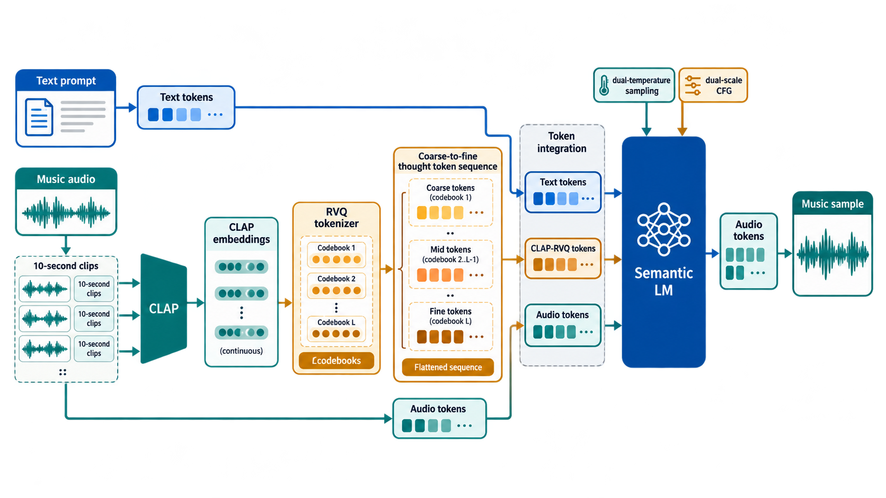

<div align="center">

# FigFox-Gen-skill · V2

### 从 Methodology 和真实证据出发，生成一张科研图。

**同类图需求锚点 · 按需配图 · 有范围的风格借鉴 · 14 组配色 · 最终 PNG1**

[English](./README.md) · [安装](#安装) · [工作流程](#工作流程) · [案例](#案例) · [版本说明](references/versions.md)

</div>

## V2 architecture / V2 架构总览

Current default workflow, visualized with FigFox-Gen itself. / 用 FigFox-Gen 自身绘制当前默认版本的完整流程。


[Methodology & generation record / 方法正文与生成记录](examples/v2-architecture/README.md)

[Editable SVG / 可编辑 SVG](assets/generated-figures/figfox-gen-v2-architecture-editable.svg) · [SVG preview / SVG 渲染预览](assets/generated-figures/figfox-gen-v2-architecture-editable.png) · [Source comparison & editability / 原图对照与可编辑性](examples/v2-architecture/editable/README.md)

`main` 默认提供 V2，发布版本为 `v2.1.0`。它从科学 Methodology 出发，形成
有来源依据的绘图计划，交付一张栅格 PNG1。细节服务于方法的实际创新，辅助模块保持
一致层级；复用已核实的缓存，按视觉需求并行处理构件证据、参考特征与配色，再由
创意师确定完整矩形布局和精确连线几何。

默认视觉优先级为：完整矩形整体、规整分区、在框内尽可能单向传导。以白底、黑字和浅色为主；只对重要内容定向着色，普通支撑区域尽量留白。

V2 按所需粒度采用标准模型的经典结构画法，默认在普通背景上使用粗体标题，把
颜色重点留给科学内容；箭头采用统一的比例与风格，可使用粗杆、圆角或手绘线条。
按需选用且已获使用许可的内容插图，通过确定性贴入保留实际素材像素。只调用一次
图像模型生成布局；生成图或贴入素材后的合成图就是唯一最终 PNG1，由作者检查实际
像素后决定是否接受，不承诺可编辑 SVG。

查看 [此前的预览案例与检查记录](examples/v3-0-1/README.md)、此前的
[布局和连线对照](examples/regular-layout-trial/README.md)，以及
[直接视觉插图合同](references/direct-visual-insets.md)。旧的独立 V2 入口已移除，当前流程统一为默认 V2；V1 仍可通过 `$figfox-gen-v1` 明确调用。

## V2 更新亮点

1. **不再出现过度配色的 Mermaid 式拓扑图。** 用主视觉参考统一图形、箭头和字体，让生成结果具有真正科研架构图的构造感。
2. **真正从简的逻辑布局。** 支持反 C、S 型和环形等排布，整体规整、饱满、对齐，尽可能单向传导，并逐条复查实际箭头的逻辑走向。
3. **反直觉的空间配色要求。** 相邻模块用相近浅色过渡，远处才拉开色彩差异，关键机制通常只保留一种强调色。
4. **图片插入开挂。** 音频波形、街景等外部图片可以按科学需要直接嵌入框架图，让具体内容进入方法表达。
5. **专家式文字压缩。** 默认靠近 100 词，删除重复解释和灰色微字，并参考同类论文的创新粒度决定自己的细节展开程度，框架创新讲框架、层级创新讲层级，用户可按需求调整。

我们也已发布 [PosFox-Gen-skill](https://github.com/LawrenceRiver/PosFox-Gen-skill)，用于将科学论文生成为科研海报图片。

## 流程概览

**V1 原版流程图**

V1 原有流程图在此原样保留，当前 V2 架构图已在首页上方重点展示。
两张总览图故意采用不同构图：英文版是横向证据链，中文版是带两侧证据分支的
自上而下主轴。

<div align="center">
  <table>
    <tr>
      <td width="72%" valign="top"></td>
      <td width="28%" valign="top"></td>
    </tr>
  </table>
</div>

## 安装

[skills CLI](https://github.com/vercel-labs/skills) 需要 Node.js 22.20 或以上。
安装默认版本，并在提示中选择 Codex：

```bash
npx skills@latest add LawrenceRiver/FigFox-Gen-skill --skill FigFox-Gen-skill
```

默认安装到当前项目；加 `-g` 可用于所有项目，加 `-a codex` 可直接选择 Codex。
已经安装的副本需要主动更新：

```bash
npx skills@latest check
npx skills@latest update FigFox-Gen-skill
```

远端仓库更新不会自动改动本地安装。手动安装或固定在 V1 的副本，可用上面的 V2
安装命令切换来源；先保存本地自定义修改。固定版本与 V1/V2 共存方法见
[版本说明](references/versions.md)。在已安装的 Skill 目录检查文件完整性：

```bash
python scripts/check_installation.py
```

使用时提供 Methodology，可选附上参考图。一般请求默认使用 V2；保留的旧版名为
`figfox-gen-v1`，只在明确指定它时调用。

## 工作流程

```text
Methodology + 约两张实际查看过的同类论文图
  → 一次形成有来源依据的视觉需求锚点
  → 复用缓存，并行处理构件证据 / 有范围的风格特征 / 配色选择
  → 需求—画法对照表 + 科学关系图
  → 创意师：创新细节、完整画布网格、符号与走线
  → V2 确定性网格/路径预检 → 紧凑 Prompt 1
  → 一次布局图生成 → 按需确定性贴入内容素材 → 最终 PNG1 → 作者检查
```

1. **先确定需求。** 查看约两个同类论文案例，只保留 Methodology 确实需要的共同
   视觉惯例。准确保留科学模块、方向关系、原文支持的贡献和必要假设。
2. **按需并行。** 查找有效的构件画法、明确喜欢的参考图特征，并从 14 组配色中
   选取适合本次任务的一组。参考图分别承担字体、线条或局部构造等明确角色，不能
   整体照搬构图、标签和颜色。每个已选视觉需求都有对应画法，不要求每个模块都搜图。
   复用已核实的缓存，只为明确未解决的需求补查；Methodology 中已命名的标准模型，
   在所选粒度使用有来源依据的经典结构画法，不凭空造符号，也不展开无关内部细节。
3. **先规划完整画布。** 创意师按创新点分配细节，在规则行列中安排所有内容与输出。
   标签使用简洁科学术语；索引采用真实上下标或经确认的符号别名，不允许可见下划线。
   输出也在同一矩形轮廓内，平级区域、边缘与间距保持对齐。标题默认是普通背景上的
   深色或主题色粗体字，不自动加彩色标题条；填色重点留给重要机制与科学内容。
   每次重新判断合适的配色，不把演示图的色相当成固定主题。
4. **先走线再生成。** 声明精确节点端口和路径点，由 V2 确定性预检检查计划几何。
   主线至多一个转弯，尽量消除交叉；不可避免的交叉必须明确使用连续跨线桥，或经
   批准且可区分的线色处理。先通过移动模块改善路径，再锁定计划；不能用文字遮住
   断裂线段。路径点规定的是中心线，不强制使用细黑线；整图及局部模型视图采用
   统一的箭头家族，保持杆身和箭头比例一致，并预留足够宽度。每条箭头都须从源边界
   连续到达目标箭头端，准确落到所指的过程子区域。
5. **只生成一次。** 将紧凑绘图清单交给图像模型，只生成一次布局图。无参考图模式下，
   清单为 `attachments: []`，图像生成调用省略 `referenced_image_paths` 和
   `num_last_images_to_include`。若选用了已检查且获准使用的直接内容素材，在预留插图
   区域确定性贴入实际文件，合成后为 PNG1；保留来源、裁剪、许可与放置记录。示意素材
   须保持示意身份，不能替代该方法的实验或结果证据。不使用插图时，生成图本身就是
   PNG1。常规流程交付这一张待检查的栅格 PNG1，不自动进入修图循环或增加模型调用。

文件、图关系、符号与几何验证检查的是声明的产物，**不能证明最终像素正确**。
实际输出的科学含义、符号、箭头端点、文字、布局与美观仍须逐项目检。
执行步骤见 [SKILL.md](SKILL.md)，产物和命令见
[紧凑生成合同](references/compact-generation.md)。旧版详细工作流保留在
[V1 标签文档](https://github.com/LawrenceRiver/FigFox-Gen-skill/blob/v1.0.0/README_ZH.md)。

## 案例

### 保留的预览：必须由作者检查

这三个选定输出生成于本次 V2 命名统一之前，展示相关流程，MusiCoT 使用靛蓝／紫色与琥珀色修订版。
它们是待检查的预览，不保证像素层面的科学与视觉验收通过。所选产物与检查见
[案例报告](examples/v3-0-1/README.md)。[英文 README](README.md#full-methodology-inputs)
完整保留三个案例的原始 Methodology，不以关键词摘要替代原文。

| Methodology | 保留的预览 |
|---|---|
| **Latent Diffusion** · [Rombach 等](https://arxiv.org/abs/2112.10752) |  |
| **MusiCoT** · [论文](https://arxiv.org/abs/2503.19611) |  |
| **AlphaFold 3** · [Abramson 等](https://www.nature.com/articles/s41586-024-07487-w) |  |

### 原样保留的 V1 案例

旧图与原路径保持不变，作为 V1 案例；历史配色预览展示的是旧版颜色库。

| V1 Methodology | 原 V1 结果 |
|---|---|
| Latent Diffusion |  |
| MusiCoT |  |
| AlphaFold 3 |  |

[V1 英文流程图](assets/generated-figures/01-figfox-gen-workflow.png) ·
[V1 中文流程图](assets/generated-figures/01-figfox-gen-workflow-zh.png) ·
[V1 FigureBench/配色预览](assets/figurebench-palette-preview.png)

## 内置参考包

安装包内有恰好 30 张完整、已索引且有署名的 FigureBench 开发集图片，以及
**14 组命名配色**。普通用户无需下载 FigureBench；不使用官方测试集图片。
FigureBench 提供几何与布局证据，不提供实际配色；FigFoxBench 是另一个独立来源。
署名信息见 [图片索引](assets/figurebench-references/index.json)。来源可访问或属于
某数据集并不等于允许重新分发；用户图片和权限未确定的素材留在本地。

## 维护者

`scripts/curate_figurebench_reference_pack.py` 用于维护参考包，
`scripts/figure_workflow.py` 用于运行产物和验证。

```bash
python scripts/check_installation.py
python -m unittest discover -s tests -v
```

检查通过不能替代像素目检。固定安装、迁移与旧版保留策略见
[版本说明](references/versions.md)。
