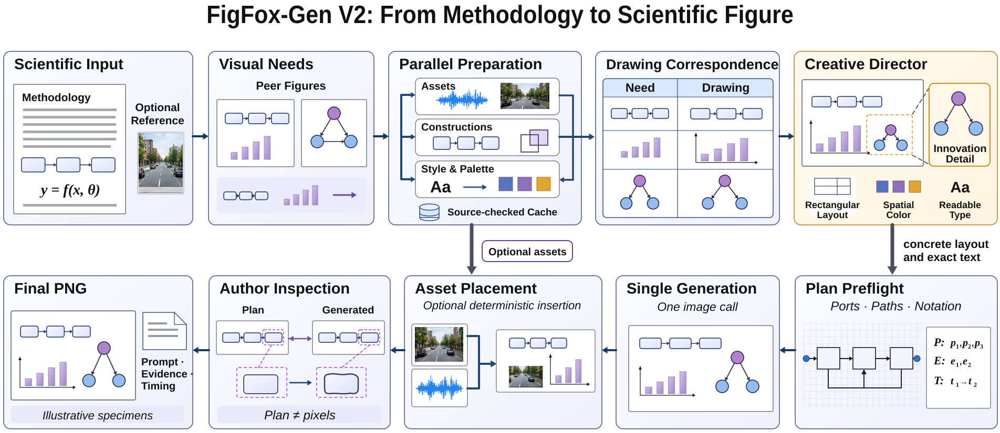

# FigFox-Gen V2 architecture overview / V2 架构总览

This overview visualizes the current generation skill itself, from Methodology and visual needs through parallel preparation, drawing correspondence, creative planning, preflight, one image call, optional asset placement and author inspection. It is not the FigFox SVG reconstruction pipeline.

这张总览图介绍当前生成技能自身的完整流程，不是 FigFox 的 SVG 重建业务。V2 为当前默认版本，V1 原图继续保留在仓库和首页。

The displayed overview is the editable SVG reconstruction; the [original first-pass PNG](../../assets/generated-figures/figfox-gen-v2-architecture.png) is preserved.

上方直接展示可编辑 SVG，首次生成 PNG 原样保留。

[English Methodology](methodology.md) · [中文 Methodology](methodology-zh.md) · [Exact generation prompt / 精确提示词](prompt.md)

## Editable SVG reconstruction / 可编辑 SVG 重建

A separate editable reconstruction is available through [FigFox](https://github.com/LawrenceRiver/FigFox), preserving the original PNG above.

另提供 FigFox 重建的[可编辑 SVG、对照图和编辑验证](editable/README.md)，上方首次 PNG 保持不变。

## Recorded checks / 检查记录

- One image call, no automatic repair; original PNG preserved unchanged.
- Planning and complete artifact/provenance validation passed; intended visible text: 66 English words.
- The right-side arrow inside Parallel Preparation can imply a dependency between independent lanes, rather than a clean join.
- Extra words and symbolic examples appear beyond the planned whitelist, and repeated tinted cards remain more prominent than intended.
- Asset imagery is illustrative; this run did not composite actual external scientific content.
- File/plan validation does not certify pixel-level scientific correctness.

只生成一次，没有自动修图；规划和完整产物验证通过。并行准备内部有一处箭头方向歧义，另有少量清单外文字及符号，保留首次结果供审阅。素材插入视图是能力示意，本次未贴入真实外部科学素材。文件与规划验证不等于像素完全正确。
