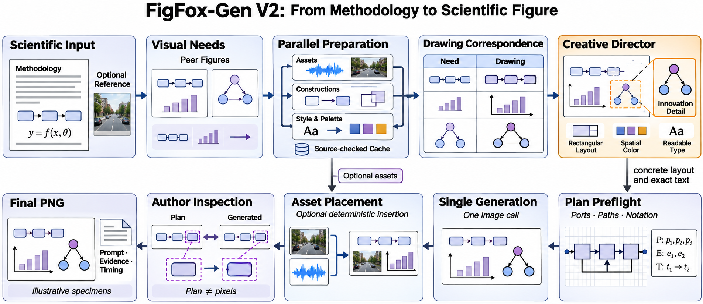
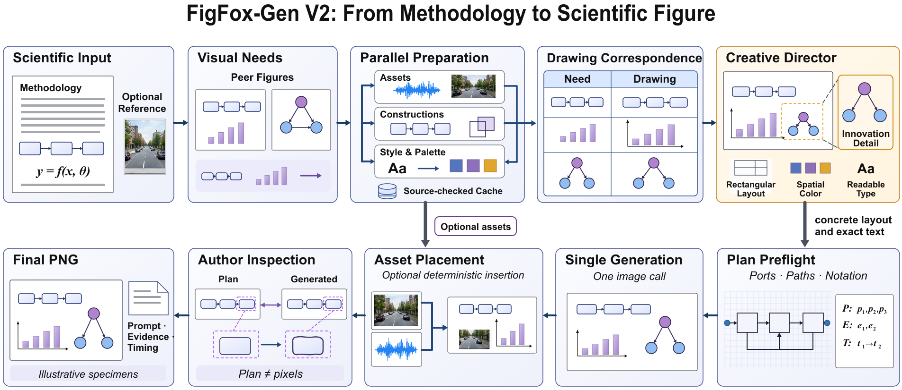

# Editable V2 architecture / V2 可编辑架构图

The original first-pass PNG is preserved. This separate SVG reconstructs it with [FigFox](https://github.com/LawrenceRiver/FigFox), using its prompts as a task-local skill and its native local editing executor. The calling assistant performed the reconstruction and sequential review passes; no external model API or SAM service was started.

保留首次生成 PNG，另提供通过 FigFox 任务内 skill 重建的可编辑 SVG；由当前助手执行重建、顺序对照检查和本地编辑，没有启动外部模型 API 或 SAM 服务。

[Download SVG / 下载 SVG](../../../assets/generated-figures/figfox-gen-v2-architecture-editable.svg) · [Rendered preview / 渲染预览](../../../assets/generated-figures/figfox-gen-v2-architecture-editable.png)

## Source and reconstruction / 原图与重建对照

| Original PNG / 原图 | Editable SVG render / 可编辑 SVG 渲染 |
|---|---|
|  |  |

## Editability / 可编辑性

- Standalone 1904×826 SVG with 66 native text elements and native shapes, charts, waveforms, arrows and groups.
- Four local street-photo crops are embedded as independently movable/replaceable images, totaling approximately 1.47% of the source canvas area; no full canvas or text panel is embedded as raster.
- Actual FigFox native operations changed a label, moved/recolored a rectangle and moved a photo in a separate editing probe; the delivered SVG remained unchanged by that probe.
- Native operations repaired title proportions, caption overflow, chart axis heads, the preflight return connection and inspection zoom geometry.
- Typography and fine rendering remain approximate; the source's ambiguous parallel-lane arrow is preserved rather than silently redesigned.
- SVG validity and successful edit execution are distinct from pixel-level fidelity and independent review.

独立 SVG 中的文字、图形、图表、波形与箭头均为原生可编辑元素；仅四处街景使用独立图片。已实际测试改字、移动/换色图形和移动照片。原图自身的并行区箭头歧义保持原样；字体、笔触和渐变存在少量近似，不声称逐像素一致或独立盲审通过。

[Editing probe / 编辑探针](editability-check.json) · [Asset manifest / 图片清单](asset-manifest.json) · [Paired observations / 对照观察](G1-observations.json) · [Scoped transactions / 局部编辑计划](G2-transactions.json) · [Execution receipts / 执行记录](native-execution.json)
