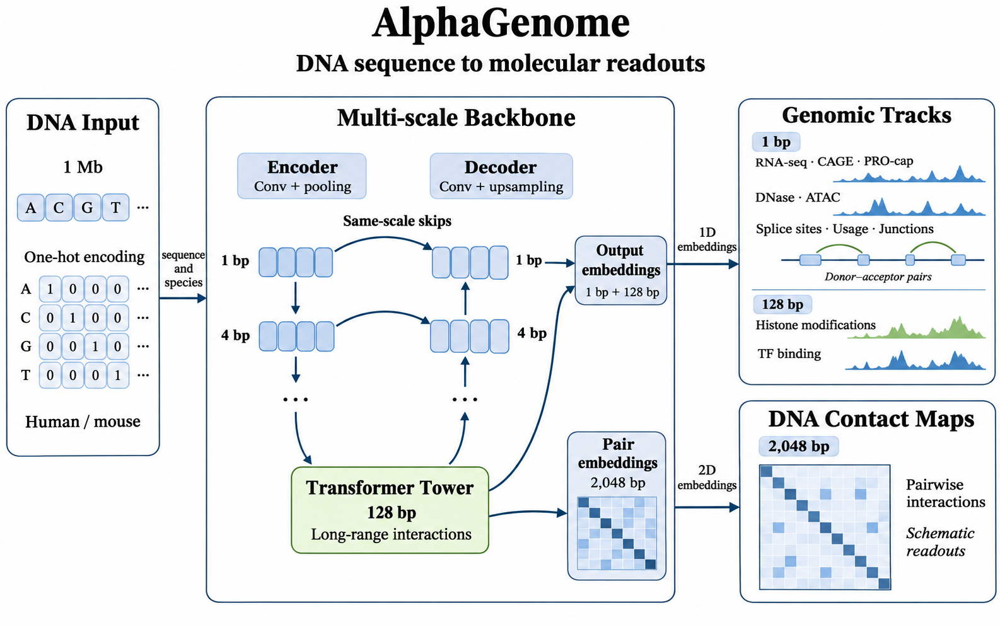

# AlphaGenome · V3 example

Generated with the SVG-reference V3 workflow on 2026-11-23. This is a visualization of the cited source method, not a claim that FigFox developed the underlying model.

- [Complete updated Methodology](input/methodology.md)
- [Image prompt](prompt-1/prompt.md) and [attachments](prompt-1/attachments.json)
- [Creative Director decisions](creative-director/brief.json)
- [Scientific and visual sources](references/web/manifest.json)
- [Generation plan](input/generation-plan.json)

## Inspection

Some connector labels extend outside their parent frames. Track/contact images are schematic, not empirical results. Original-model scope and corrected 128-bp bottleneck are retained.

File/schema checks and visual inspection are distinct. Known deviations are retained with the original generation rather than hidden by relabeling it as final. The original source URLs, palette provenance and scoped reference use are recorded in the run files. Third-party SVGs remain attributed to their original authors; they are reference evidence, not FigFox-generated outputs.
