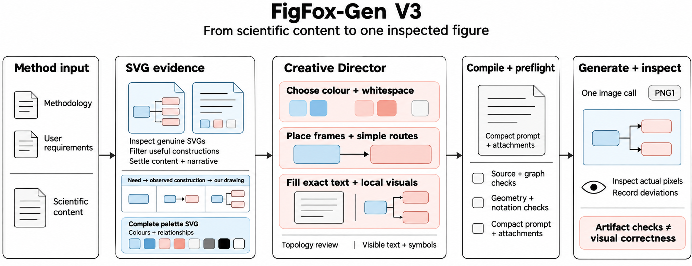

# FigFox-Gen V3 architecture

This overview was generated with our own **FigFox-Gen V3 skill**, using the current repository workflow as its Methodology. It explains how the calling agent converts scientific content and SVG evidence into Director decisions, a checked prompt, one generated PNG and actual image inspection. It is an orchestration workflow, not a newly trained neural architecture.

- [Full Methodology](input/methodology.md)
- [Creative Director request](creative-director/prompt.md) and [actual decisions](creative-director/brief.json)
- [Generation plan](input/generation-plan.json)
- [Final compiled prompt](prompt-1/prompt.md) and [actual attachment manifest](prompt-1/attachments.json)
- [Reference evidence](references/web/manifest.json)
- [Actual-pixel inspection and limitations](inspection.md)

Colour relationships derive from the complete SVG in [Feature-wise transformations](https://distill.pub/2018/feature-wise-transformations/), attributed in the retained style brief and source files. MusicGen and CosyVoice SVGs contribute scoped construction grammar only; a same-track reference gap is recorded.

One built-in image-generation call; no subsequent image repair or SVG reconstruction. Mild shading and one repeated compiler label are retained and disclosed.

## Editable illustrated version

[Native SVG with run-record screenshots and case illustrations](editable/README.md) · [SVG](editable/final.svg) · [Preview](editable/final.png)
