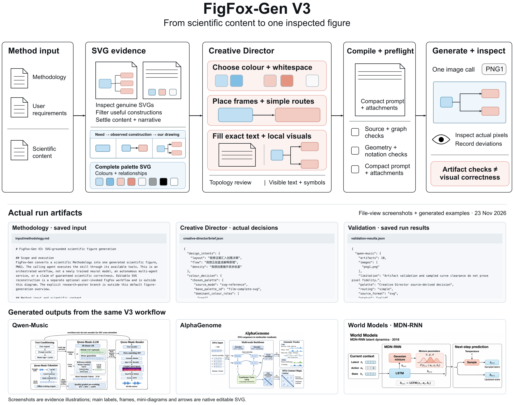

# Editable V3 overview with real run illustrations

[Download standalone editable SVG](final.svg) · [PNG preview](final.png)

Reconstructed with our own **FigFox skill** from [the V3 generated overview](../png1.png), then extended at the user’s request with three actual saved-file browser screenshots and three generated case thumbnails. The file is self-contained. Main labels, frames, arrows and miniature diagrams are native editable SVG; the six images can be moved or replaced independently.

The screenshots show local HTML previews of the actual Methodology, Creative Director brief and saved validation result JSON. They are not captures of the original Codex chat UI. Original screenshot files and their HTML previews are in `assets/`; the SVG uses cropped excerpts for readable illustration. Generated case previews are the exact stored PNGs, with their known deviations retained.

## Checks

The same assistant compared source/draft whole views and four paired quadrants, repaired oversized miniatures and verified a separate edit probe by rendering an actual title change, frame stroke change and embedded-image movement. The final file’s hash remained unchanged. See [editability check](editability-check.json), [asset inventory](asset-manifest.json) and [observations](observations.json).

Fonts, document details and flat fills approximate the generated raster; this is not a pixel-perfect font/gradient copy. The source duplicate compiler label is preserved. Screenshot text remains raster; main workflow text stays native.
